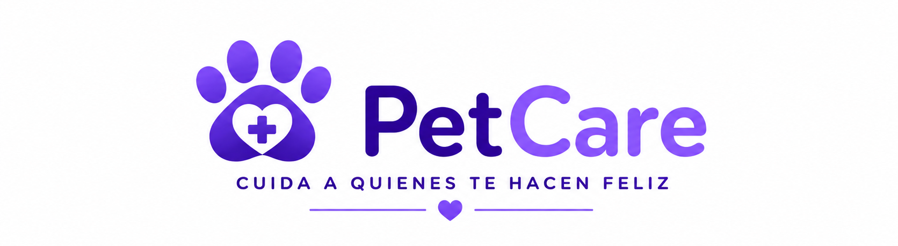
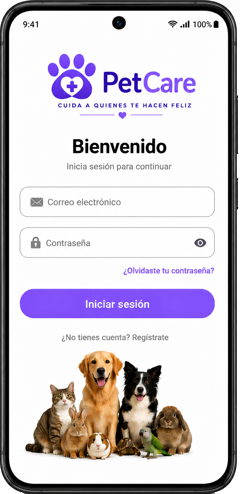

# PetCare 

<p align="center">
  
</p>

<h3 align="center">
Aplicación móbil orientada á organización e seguimento integral do coidado diario das mascotas.
</h3>

<p align="center"> ──────────────────────────────────────────────────────────────── </p>

---

## Descrición

PetCare é unha aplicación móbil desenvolvida co obxectivo de centralizar nun único lugar toda a información relacionada co coidado dunha mascota. A aplicación permite rexistrar mascotas e realizar un seguimento organizado de datos importantes como o peso, eventos relevantes, información sanitaria, alimentación ou outros aspectos relacionados co seu benestar.

Na práctica diaria, moita desta información adoita quedar repartida entre notas, recordatorios, mensaxes ou documentos en papel, dificultando o seu acceso e aumentando a probabilidade de esquecementos. PetCare busca resolver este problema ofrecendo unha ferramenta intuitiva, accesible e pensada para o uso real.

A aplicación está deseñada para funcionar tanto con almacenamento local como mediante sincronización na nube, permitindo manter a información dispoñible mesmo en situacións sen conexión e sincronizando os cambios posteriormente.

Ademais, o proxecto nace tamén dunha motivación persoal relacionada coa importancia de realizar un seguimento máis organizado do estado e necesidades dunha mascota.

---

## Instalación / Posta en marcha

PetCare poderá utilizarse mediante instalación directa do ficheiro APK no dispositivo Android. Ademais, durante o desenvolvemento tamén poderá executarse localmente desde Android Studio.

### Instalación mediante APK

Descargar:

```text
APK dispoñible proximamente
```

Pasos:

- Descargar o ficheiro APK
- Activar a instalación desde fontes externas no dispositivo
- Executar o ficheiro descargado
- Completar a instalación

Unha vez instalada, a aplicación estará lista para o seu uso.

### Execución en ambiente local

Requisitos:

- Android Studio
- Java JDK 17 ou superior
- Android SDK actualizado
- Emulador Android ou dispositivo Android físico
- Conexión a internet

Clonar o repositorio:

```bash
git clone https://gitlab.com/iesleliadoura/DAM2/martin-miguens.git
```

Abrir o proxecto mediante Android Studio.

Executar:

```bash
Run > Run app
```

ou:

```bash
Shift + F10
```

---

## Uso

PetCare foi deseñado para ofrecer unha experiencia simple e intuitiva.

Fluxo principal actual:

```text
Pantalla inicial
      ↓
Inicio de sesión
      ↓
Listado de mascotas
      ↓
Información detallada
```

Funcionalidades implementadas e previstas:

- Rexistro de mascotas
- Xestión de información asociada
- Seguimento de peso
- Rexistro de eventos importantes
- Sistema de autenticación
- Sincronización local e nube
- Xestión compartida entre usuarios



---

## Sobre o autor

Son estudante do ciclo superior de Desenvolvemento de Aplicacións Multiplataforma (DAM), interesado especialmente no desenvolvemento de aplicacións móbiles e no deseño de interfaces intuitivas.

Ao longo da formación traballei con tecnoloxías como Java, Android Studio, XML, SQL, Git e ferramentas de modelado.

Escollín PetCare porque combina unha necesidade real cunha motivación persoal. O obxectivo é desenvolver unha ferramenta útil, práctica e adaptable ao día a día dos propietarios de mascotas.

Contacto:

- GitHub: martinmgd
- GitLab: martinmgd
- Correo: martin_mgd@hotmail.com

---

## Licenza

PetCare distribúese baixo a licenza MIT.

Esta licenza permite o uso, copia, modificación e distribución do software mantendo o aviso de copyright orixinal.

Para máis información consultar o arquivo [LICENSE](LICENSE).

---

## Índice

1. Anteproxecto
   * 1.1 [Idea](doc/templates/1_idea.md)
   * 1.2 [Necesidades](doc/templates/2_necesidades.md)

2. [Análise](doc/templates/3_analise.md)

3. [Planificación](doc/templates/4_planificacion.md)

4. [Deseño](doc/templates/5_deseño.md)

5. Implantación
   * 5.1 [Implementación](doc/templates/6_implementacion.md)
   * 5.2 [Produción](doc/templates/7_producion.md)

---

## Guía de contribución

PetCare é un proxecto aberto á mellora continua.

Pódese colaborar mediante:

- Corrección de erros
- Optimización do código
- Melloras de interface
- Novas funcionalidades
- Probas automatizadas
- Actualización da documentación

As modificacións realizaranse mediante ramas específicas e integración posterior mediante Pull Requests.

---

## Links

- [Android Studio](https://developer.android.com/studio)
- [SQLite](https://www.sqlite.org)
- [Room](https://developer.android.com/training/data-storage/room)
- [Supabase](https://supabase.com)
- [DBDiagram](https://dbdiagram.io)
- [GitLab](https://gitlab.com)