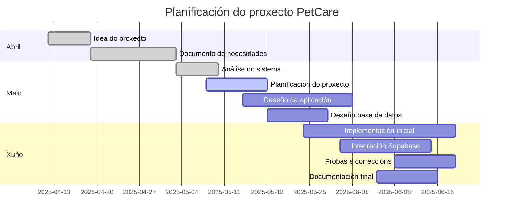
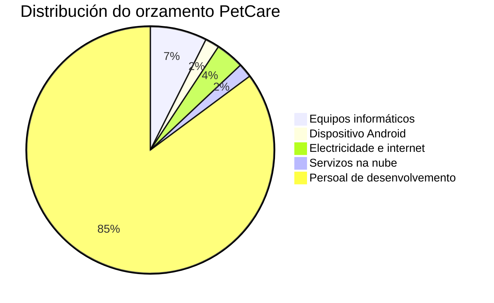

# FASE DE PLANIFICACIÓN DO PROXECTO

## Obxectivos do proxecto

O obxectivo principal do proxecto é desenvolver unha aplicación móbil Android chamada **PetCare**, orientada á xestión e seguimento do coidado de mascotas.

A aplicación permitirá rexistrar información relacionada coa alimentación, actividade, peso, citas, medicación e eventos importantes da mascota. Ademais, contemplará a xestión compartida entre varios usuarios, empregando SQLite/Room como sistema principal de almacenamento local e Supabase para a sincronización e almacenamento dos datos na nube.

---

## Guía de planificación do proxecto

O proxecto dividirase nas seguintes fases:

1. [Análise de requisitos](#fase-1-análise-de-requisitos)
2. [Deseño da aplicación](#fase-2-deseño-da-aplicación)
3. [Deseño e configuración da base de datos](#fase-3-deseño-e-configuración-da-base-de-datos)
4. [Desenvolvemento da aplicación móbil](#fase-4-desenvolvemento-da-aplicación-móbil)
5. [Integración e sincronización](#fase-5-integración-e-sincronización)
6. [Probas e corrección de erros](#fase-6-probas-e-corrección-de-erros)
7. [Documentación final e presentación](#fase-7-documentación-final-e-presentación)

---

## Metodoloxía

Empregarase unha metodoloxía incremental, xa que permite desenvolver primeiro unha versión básica funcional da aplicación e, posteriormente, engadir novas funcionalidades de forma progresiva.

Esta metodoloxía resulta adecuada para o proxecto porque permite validar cada parte do sistema antes de continuar coa seguinte, reducindo riscos e facilitando a corrección de erros durante o desenvolvemento.

---

## Fases planificadas

## Fase 1: Análise de requisitos

### Tarefa 1: Definición das funcionalidades principais

**Descrición:**
Identificación das funcionalidades necesarias para a aplicación, como xestión de mascotas, alimentación, actividade, medicación, citas e usuarios compartidos.

**Recursos hardware/software:**
Ordenador persoal, navegador web, Visual Studio Code.

**Recursos humanos:**
Desenvolvedor do proxecto.

**Duración:**
20 horas.

---

### Tarefa 2: Revisión da documentación inicial

**Descrición:**
Revisión dos documentos de idea, necesidades e análise para asegurar a coherencia do proxecto.

**Recursos hardware/software:**
Visual Studio Code, GitLab.

**Recursos humanos:**
Desenvolvedor do proxecto.

**Duración:**
15 horas.

---

## Fase 2: Deseño da aplicación

### Tarefa 1: Deseño das pantallas

**Descrición:**
Deseño das pantallas principais da aplicación: inicio de sesión, rexistro, listado de mascotas, detalle da mascota, alimentación, actividade, citas e medicación.

**Recursos hardware/software:**
Figma, Draw.io ou ferramenta similar.

**Recursos humanos:**
Desenvolvedor do proxecto.

**Duración:**
25 horas.

---

### Tarefa 2: Deseño da navegación

**Descrición:**
Definición do fluxo de navegación entre as distintas pantallas da aplicación.

**Recursos hardware/software:**
Figma, Draw.io.

**Recursos humanos:**
Desenvolvedor do proxecto.

**Duración:**
20 horas.

---

## Fase 3: Deseño e configuración da base de datos

### Tarefa 1: Deseño do modelo de datos

**Descrición:**
Definición da estrutura de datos para usuarios, mascotas, usuarios asociados, alimentación, actividade, eventos, medicación e pautas.

**Recursos hardware/software:**
DBDiagram.io, Supabase.

**Recursos humanos:**
Desenvolvedor do proxecto.

**Duración:**
35 horas.

---

### Tarefa 2: Configuración de SQLite/Room

**Descrición:**
Preparación do sistema principal de almacenamento local mediante SQLite/Room para garantir o funcionamento da aplicación sen conexión a internet.

**Recursos hardware/software:**
Android Studio, Java, Room/SQLite.

**Recursos humanos:**
Desenvolvedor do proxecto.

**Duración:**
25 horas.

---

### Tarefa 3: Configuración de Supabase

**Descrición:**
Creación do proxecto en Supabase, configuración inicial da base de datos e autenticación.

**Recursos hardware/software:**
Supabase, navegador web.

**Recursos humanos:**
Desenvolvedor do proxecto.

**Duración:**
20 horas.

---

## Fase 4: Desenvolvemento da aplicación móbil

### Tarefa 1: Creación do proxecto Android

**Descrición:**
Creación da estrutura inicial do proxecto en Android Studio.

**Recursos hardware/software:**
Android Studio, Java.

**Recursos humanos:**
Desenvolvedor do proxecto.

**Duración:**
10 horas.

---

### Tarefa 2: Implementación de rexistro e inicio de sesión

**Descrición:**
Desenvolvemento do sistema de autenticación de usuarios.

**Recursos hardware/software:**
Android Studio, Java, Supabase Auth.

**Recursos humanos:**
Desenvolvedor do proxecto.

**Duración:**
35 horas.

---

### Tarefa 3: Implementación da xestión de mascotas

**Descrición:**
Creación das funcionalidades para engadir, modificar, eliminar e consultar mascotas.

**Recursos hardware/software:**
Android Studio, Java, Supabase.

**Recursos humanos:**
Desenvolvedor do proxecto.

**Duración:**
60 horas.

---

### Tarefa 4: Implementación da alimentación e actividade

**Descrición:**
Desenvolvemento das pantallas e funcionalidades relacionadas co rexistro de comidas, paseos e actividade diaria.

**Recursos hardware/software:**
Android Studio, Java, Supabase.

**Recursos humanos:**
Desenvolvedor do proxecto.

**Duración:**
70 horas.

---

### Tarefa 5: Implementación de citas, eventos e medicación

**Descrición:**
Creación das funcionalidades para rexistrar citas veterinarias, vacinas, medicacións e pautas.

**Recursos hardware/software:**
Android Studio, Java, Supabase.

**Recursos humanos:**
Desenvolvedor do proxecto.

**Duración:**
80 horas.

---

### Tarefa 6: Xestión compartida de mascotas

**Descrición:**
Implementación dun sistema para asociar varios usuarios a unha mesma mascota mediante un código de invitación.

**Recursos hardware/software:**
Android Studio, Java, Supabase.

**Recursos humanos:**
Desenvolvedor do proxecto.

**Duración:**
50 horas.

---

## Fase 5: Integración e sincronización

### Tarefa 1: Integración con SQLite/Room

**Descrición:**
Uso de SQLite/Room como sistema principal de almacenamento local para garantir a dispoñibilidade da información e o funcionamento da aplicación sen conexión.

**Recursos hardware/software:**
Android Studio, Java, Room/SQLite.

**Recursos humanos:**
Desenvolvedor do proxecto.

**Duración:**
25 horas.

---

### Tarefa 2: Integración da aplicación con Supabase

**Descrición:**
Conexión das funcionalidades da aplicación coa base de datos na nube.

**Recursos hardware/software:**
Android Studio, Java, Supabase.

**Recursos humanos:**
Desenvolvedor do proxecto.

**Duración:**
35 horas.

---

### Tarefa 3: Copias de seguridade

**Descrición:**
Deseño dun sistema básico para conservar e recuperar información relevante.

**Recursos hardware/software:**
Supabase, Android Studio.

**Recursos humanos:**
Desenvolvedor do proxecto.

**Duración:**
20 horas.

---

## Fase 6: Probas e corrección de erros

### Tarefa 1: Probas funcionais

**Descrición:**
Comprobación do funcionamento das funcionalidades principais da aplicación.

**Recursos hardware/software:**
Android Studio, dispositivo Android.

**Recursos humanos:**
Desenvolvedor do proxecto.

**Duración:**
30 horas.

---

### Tarefa 2: Probas de integración

**Descrición:**
Verificación da comunicación entre a aplicación, Supabase e o almacenamento local.

**Recursos hardware/software:**
Android Studio, Supabase, dispositivo Android.

**Recursos humanos:**
Desenvolvedor do proxecto.

**Duración:**
25 horas.

---

### Tarefa 3: Corrección de erros

**Descrición:**
Corrección dos erros detectados durante as probas.

**Recursos hardware/software:**
Android Studio, GitLab.

**Recursos humanos:**
Desenvolvedor do proxecto.

**Duración:**
35 horas.

---

## Fase 7: Documentación final

### Tarefa 1: Elaboración da documentación final

**Descrición:**
Redacción e revisión da documentación técnica do proxecto.

**Recursos hardware/software:**
Visual Studio Code, GitLab.

**Recursos humanos:**
Desenvolvedor do proxecto.

**Duración:**
20 horas.

---

## Diagrama de Gantt

O seguinte diagrama representa a planificación temporal estimada das diferentes fases do proxecto.

---

## Orzamento

Para o cálculo do orzamento considérase un custo estimado de **15 €/hora** para o traballo de desenvolvemento.

### Orzamento por actividade

| ACTIVIDADE                              | DURACIÓN | CUSTO PERSOAS | RECURSOS MATERIAIS | CUSTO TOTAL |
| --------------------------------------- | -------: | ------------: | -----------------: | ----------: |
| Análise de requisitos                   |     25 h |         375 € |                0 € |       375 € |
| Deseño da aplicación                    |     35 h |         525 € |                0 € |       525 € |
| Deseño e configuración da base de datos |     50 h |         750 € |                0 € |       750 € |
| Desenvolvemento da aplicación móbil     |    220 h |        3300 € |                0 € |      3300 € |
| Integración e sincronización            |     50 h |         750 € |              150 € |       900 € |
| Probas e corrección de erros            |     50 h |         750 € |                0 € |       750 € |
| Documentación final e presentación      |     30 h |         450 € |                0 € |       450 € |
| **TOTAL**                               | **460 h** |   **6900 €** |          **150 €** | **7050 €** |

---

O orzamento por actividade recolle o custo asociado ao traballo directo do proxecto, mentres que o orzamento por partidas inclúe tamén investimentos e outros gastos asociados.

### Orzamento por partidas de investimento / gasto

| CONCEPTO                        | IMPORTE |
| ------------------------------- | ------: |
| Equipos informáticos            |   600 € |
| Dispositivo Android para probas |   150 € |
| Electricidade e internet        |   300 € |
| Servizos na nube / Supabase     |   150 € |
| Persoal de desenvolvemento      |  6900 € |
| **TOTAL ORZAMENTO**             | **8100 €** |

---

### Distribución do orzamento

---

## WEBGRAFÍA

* [https://supabase.com/docs](https://supabase.com/docs)
* [https://developer.android.com](https://developer.android.com)
* [https://developer.android.com/training/data-storage/room](https://developer.android.com/training/data-storage/room)
* [https://mermaid.js.org](https://mermaid.js.org)
