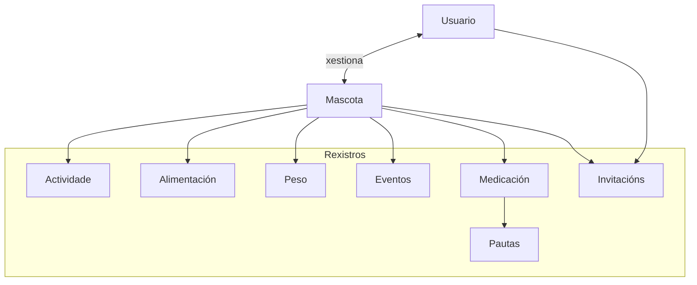
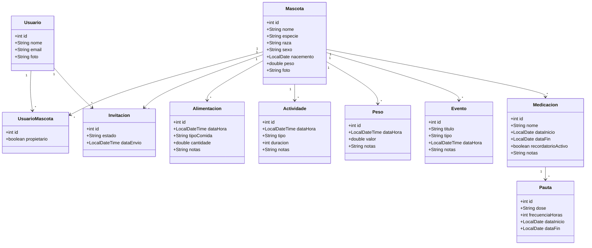
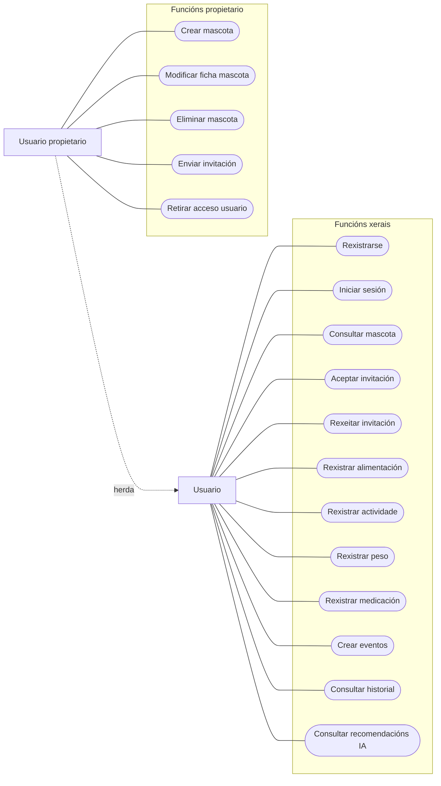
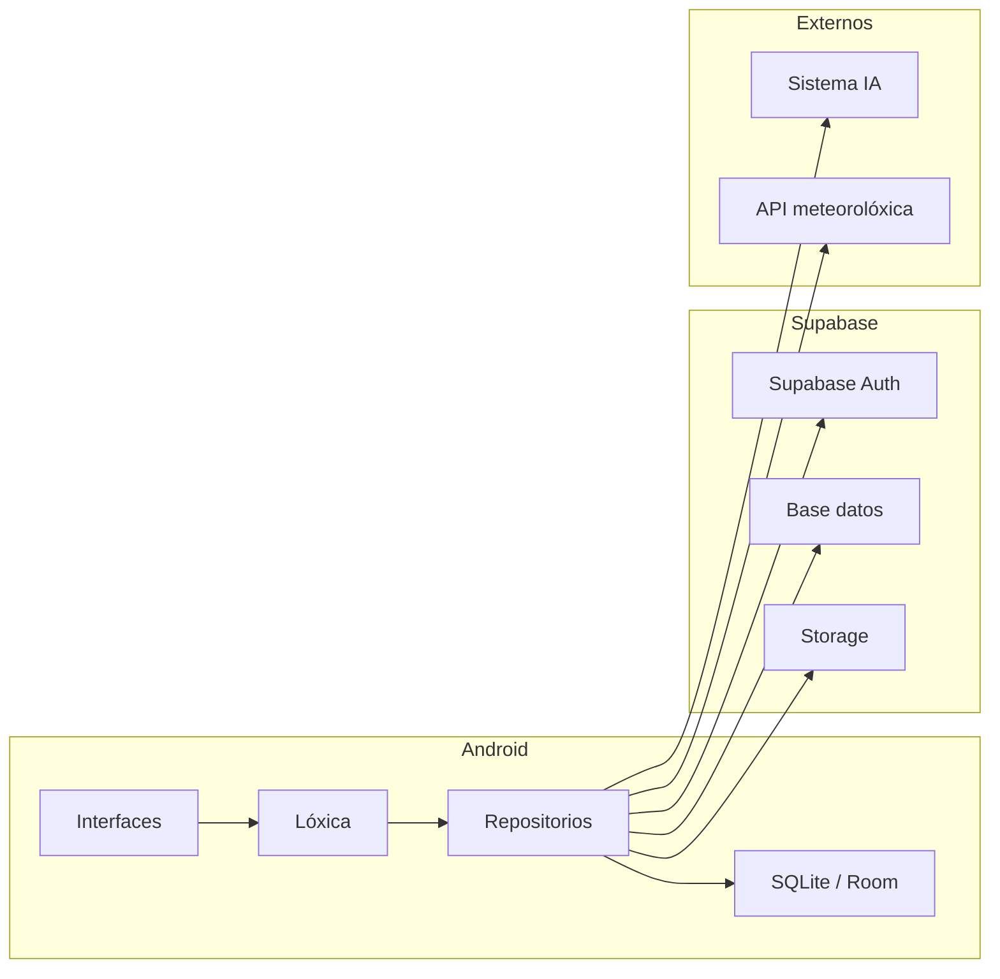
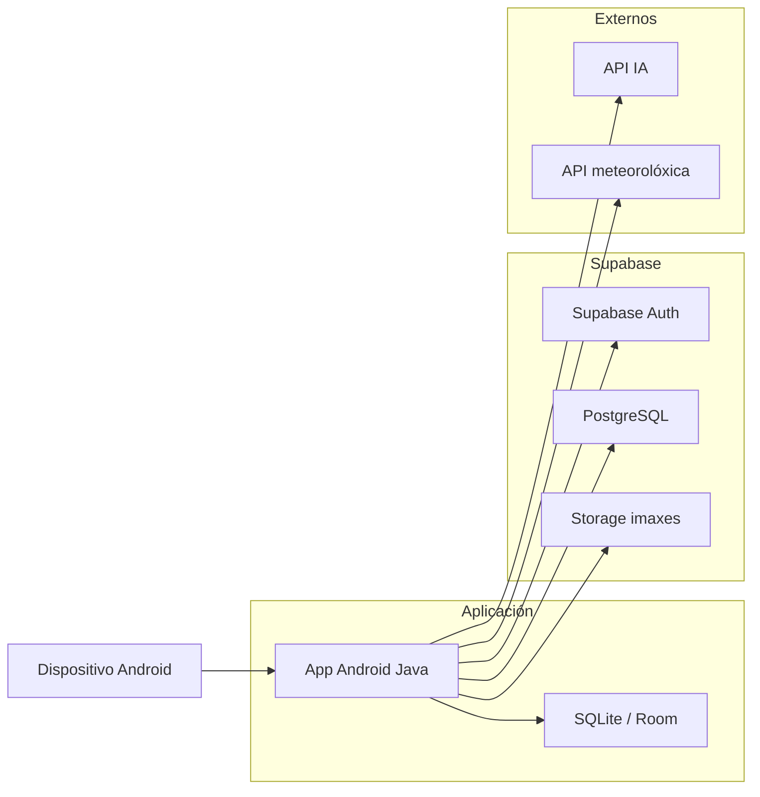

# DESEÑO

## Guía do documento

1. [Modelo conceptual do dominio da aplicación](#modelo-conceptual-do-dominio-da-aplicación)
2. [Diagrama de clases](#diagrama-de-clases)
3. [Casos de uso](#casos-de-uso)
4. [Deseño de interfaces de usuario](#deseño-de-interfaces-de-usuario)
5. [Diagrama de Base de Datos](#diagrama-de-base-de-datos)
6. [Diagrama de compoñentes software](#diagrama-de-compoñentes-software)
7. [Diagrama de despregamento](#diagrama-de-despregamento)
8. [Calidade](#calidade)

---

## Deseño do proxecto

Nesta fase descríbese a estrutura xeral do proxecto PetCare, definindo os principais elementos do sistema, a organización dos compoñentes e os modelos necesarios para comprender o funcionamento da aplicación antes da implementación.

---

## Modelo conceptual do dominio da aplicación

O dominio da aplicación organízase tomando como elemento principal a mascota, xa que a maior parte das accións realizadas polos usuarios estarán asociadas a ela.

A partir desta entidade estrutúranse os diferentes rexistros relacionados coa actividade diaria, alimentación, medicación e colaboración entre usuarios.

Este modelo conceptual sitúa a mascota como entidade central do sistema. Ao seu redor organízanse os distintos rexistros relacionados co coidado diario, permitindo ademais a colaboración entre varios usuarios mediante invitacións.

---

## Diagrama de clases

A organización das clases permite representar os distintos elementos necesarios para o funcionamento da aplicación e definir a relación existente entre eles.

Esta estrutura servirá como base para a implementación das entidades e o almacenamento posterior da información.

Este diagrama representa a organización das entidades principais da aplicación, definindo a estrutura de datos e as relacións necesarias para o funcionamento do sistema.

---

## Casos de uso

Os casos de uso permiten identificar as accións dispoñibles dentro da aplicación desde o punto de vista dos usuarios.

Ademais, facilitan distinguir os permisos adicionais asociados ao propietario da mascota respecto ao resto de usuarios.

Todos os usuarios poden rexistrar e consultar información asociada ás mascotas ás que teñan acceso. O usuario propietario dispón ademais de permisos adicionais para administrar a mascota creada.

---

## Deseño de interfaces de usuario

Debido a que a interface da aplicación poderá evolucionar durante o desenvolvemento do proxecto, nesta fase non se inclúen mockups definitivos.

Inicialmente prevese a existencia das seguintes pantallas:

* Inicio de sesión e rexistro
* Pantalla principal de mascotas
* Detalle da mascota
* Alimentación
* Actividade
* Rexistro de peso
* Medicación
* Eventos e citas
* Invitacións
* Perfil de usuario
* Recomendacións IA

As capturas reais da aplicación incorporaranse unha vez implementadas.

---

## Diagrama de Base de Datos

A estrutura da base de datos deseñouse co obxectivo de almacenar e organizar a información empregada pola aplicación, permitindo relacionar os distintos elementos do sistema de forma coherente.

As entidades definidas permiten xestionar información asociada ás mascotas, usuarios, rexistros diarios, eventos e colaboración entre distintos usuarios.

A aplicación empregará unha arquitectura híbrida de almacenamento, utilizando SQLite/Room para a persistencia local dos datos no dispositivo e Supabase como servizo de sincronización, autenticación e almacenamento na nube.

Esta solución permitirá manter a información dispoñible incluso en ausencia de conexión, sincronizando automaticamente os cambios cando exista acceso á rede.

---

## Diagrama de compoñentes software

A aplicación distribúe as súas funcionalidades en diferentes módulos co obxectivo de separar responsabilidades e simplificar o desenvolvemento.

Esta organización permite incorporar novas funcionalidades no futuro sen afectar ao funcionamento xeral do sistema.

O sistema estrutúrase mediante unha arquitectura baseada en capas, separando interface, lóxica e almacenamento para facilitar o mantemento e a escalabilidade.

---

## Diagrama de despregamento

Este diagrama mostra a distribución física dos compoñentes da aplicación e a súa comunicación cos servizos externos empregados.

---

## Calidade

Co obxectivo de garantir un funcionamento correcto da aplicación PetCare estableceranse diferentes medidas orientadas a asegurar a estabilidade do sistema, a integridade da información e unha experiencia de uso adecuada.

### Seguimento do funcionamento

* Revisión periódica das funcionalidades implementadas.
* Comprobación do comportamento xeral da aplicación durante o desenvolvemento.
* Verificación do cumprimento dos requisitos definidos inicialmente.

### Validación do sistema

* Realización de probas sobre os distintos módulos da aplicación.
* Comprobación do correcto intercambio de datos entre compoñentes.
* Identificación e corrección de posibles incidencias detectadas.

### Mantemento do código

* Uso de Git e GitLab para o seguimento do desenvolvemento.
* Organización do código de forma estruturada e modular.
* Rexistro continuo dos cambios realizados no proxecto.

### Consistencia dos datos

* Sincronización entre almacenamento local mediante SQLite/Room e servizos na nube.
* Conservación da información incluso en situacións sen conexión.
* Verificación da coherencia dos datos sincronizados.

### Protección e acceso

* Autenticación de usuarios mediante Supabase.
* Validación dos datos introducidos na aplicación.
* Limitación do acceso ás mascotas segundo os permisos asignados.

### Documentación

* Actualización progresiva da documentación do proxecto.
* Uso de diagramas e modelos para representar a estrutura do sistema.
* Mantemento dunha descrición clara das decisións de deseño adoptadas.

---

## Ferramentas empregadas para os diagramas

A maior parte dos diagramas incluídos na documentación foron elaborados mediante [Mermaid](https://mermaid.js.org), empregando o editor [Mermaid Live Editor](https://mermaid.live) para a súa creación e validación.

Para o deseño do modelo de base de datos empregouse [DBDiagram](https://dbdiagram.io), ferramenta especializada na definición visual de estruturas relacionais e na representación das relacións entre entidades.

Ambas ferramentas permitiron xerar diagramas facilmente modificables e integrables na documentación do proxecto en formato Markdown.